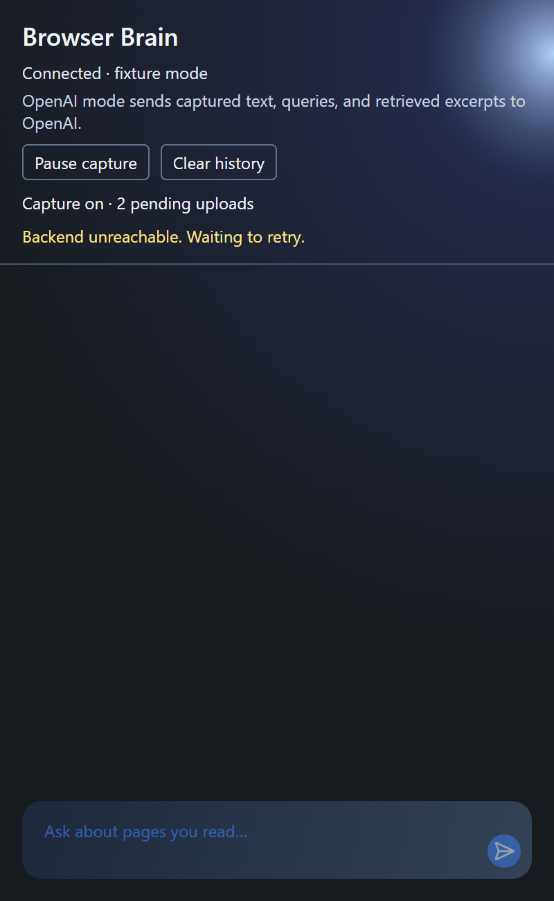
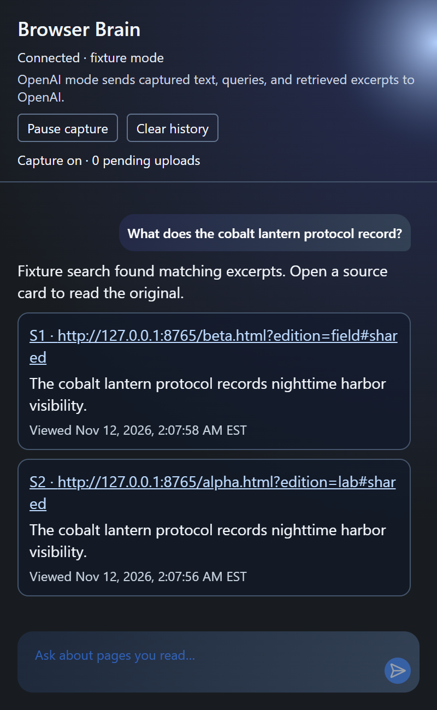

<div align="center">

<h1>🧠 Browser Brain</h1>
<h3>Remember what you read? Find the page again in Chrome.</h3>

<p>Ask in your own words, check the excerpt and when you viewed it, then open the original page.</p>

<p>
  <a href="web-extension/public/manifest.json"></a>
  <a href="web-extension/package.json"></a>
  <a href="docs/architecture.md"></a>
</p>

<p>
  <a href="#try-demo"></a>
  &nbsp;
  <a href="#windows-setup"></a>
</p>

<a href="docs/screenshots/browser-brain-cover.png"></a>

</div>

---

## 💡 Why Browser Brain?

You remember an interesting detail from something you read, but the title, website, and search terms escape you. Browser Brain lets you ask about the detail you remember.

- 🔎 **Search in your own words.** Ask a question right in the Chrome popup.
- 🔗 **Return to the original page.** Each source card shows the full URL, an excerpt, and when you viewed it.
- 📑 **Find both pages that share a passage.** Identical text on two pages can still lead you back to either source.
- 🔄 **Pick up after a disconnect.** Queued content stays on your device and uploads retry when the connection returns.
- 🎛️ **Control what gets captured.** Start, pause, and clear Browser Brain from the popup.

---

<a id="try-demo" name="try-demo"></a>

## 🖼️ See Browser Brain in action

### Two pages with the same passage

> **Demo question** “What does the cobalt lantern protocol record?”

<table>
  <tr>
    <th width="50%" align="center">Upload interrupted</th>
    <th width="50%" align="center">Search after recovery</th>
  </tr>
  <tr>
    <td align="center"><a href="docs/screenshots/browser-brain-pending.png"></a></td>
    <td align="center"><a href="docs/screenshots/browser-brain-search-result.png"></a></td>
  </tr>
</table>

These Chrome screenshots use sample data. **Harbor field notes** and **Marsh field notes** share a passage about the *cobalt lantern protocol*. After an interrupted upload, Browser Brain finds both pages and shows when each was viewed.

1. Follow the [Windows setup](#windows-setup) and choose **Try with sample data**.
2. Open [Harbor field notes](http://127.0.0.1:8765/alpha.html?edition=lab#shared), click **Enable capture**, then follow **Open marsh notes** in the same tab.
3. Wait for **pending uploads** to reach 0. Ask the demo question and click a source card. Check the URL and **Viewed** timestamp.

To test recovery yourself, stop the local backend before reading the sample pages. Start it again, reopen the popup, and wait for the queue to empty. [Full recovery walkthrough (Vietnamese)](docs/demo.md)

---

## 📖 Capture while you read

- **Enable capture** starts saving visible text on HTTP(S) pages you open, including paragraphs, headings, and list items.
- **Pause capture** stops new capture. Queued items still upload when the local backend reconnects.
- **Clear history** pauses capture and removes Browser Brain's saved content, chats, and pending uploads. If the process is interrupted, restart the backend and select **Finish clearing**. Chrome manages its own browsing history separately.

## 🔒 Where your data goes

| Component | What it does |
| --- | --- |
| **Chrome extension** | Captures text when enabled and stores pending uploads in Chrome. |
| **Local FastAPI backend and Qdrant** | Index captured text for retrieval. Chat history is also stored in your local data folder. |
| **OpenAI mode** | Sends captured text and questions to OpenAI for matching. It also sends the question, retrieved excerpts, and view times to generate an answer. |
| **Demo mode** | Uses sample pages and local search. You can try it without an OpenAI key. |

Set your OpenAI key in `backend/.env` on your machine. [Architecture and storage configuration (Vietnamese)](docs/architecture.md)

---

<a id="windows-setup" name="windows-setup"></a>

## 🚀 Install and run on Windows

You'll need **Chrome 120 or later**, **Node.js 24**, **Git**, and **uv**. Use PowerShell for the commands below. [Install Node.js](https://nodejs.org/en/download) · [Install Git](https://git-scm.com/install/windows) · [Install uv](https://docs.astral.sh/uv/getting-started/installation/)

### Step 1 · Build and load the extension

If you already have the project, open PowerShell in its folder and start with `Set-Location web-extension`. If GitHub asks you to sign in, use an account with access to the repository.

```powershell
git clone https://github.com/DTran228/browser-brain.git
Set-Location browser-brain
Set-Location web-extension
npm.cmd ci
npm.cmd run build
Set-Location ..
```

1. Open `chrome://extensions` and turn on **Developer mode**.
2. Click **Load unpacked** and select the `web-extension\dist` folder you just built.
3. Pin Browser Brain from the Chrome Extensions menu.

### Step 2 · Set up the local backend

From the project folder, run:

```powershell
Set-Location backend
uv python install 3.11
uv sync --locked
```

### Option 1 · Try with sample data

In the same PowerShell window, run:

```powershell
$env:BROWSER_BRAIN_PROVIDER = 'fixture'
$env:BROWSER_BRAIN_DATA = Join-Path (Split-Path -Parent $PWD.Path) '.local\readme-demo'
uv run --locked python src/main.py
```

Keep this window open. The popup should show **Connected · fixture mode**. Open a **second PowerShell window in the project folder** and run:

```powershell
.\backend\.venv\Scripts\python.exe -m http.server 8765 --bind 127.0.0.1 --directory demo
```

Return to the [two-page demo](#try-demo). When you're finished, press **Ctrl+C** in both windows.

### Option 2 · Find pages you read every day

Stop the demo and use a separate Chrome profile for your own browsing. Open a new PowerShell window in the project folder and run:

```powershell
Set-Location backend
if (!(Test-Path .env)) { Copy-Item .env.example .env }
notepad .env
```

Enter your `OPENAI_API_KEY`, keep `BROWSER_BRAIN_PROVIDER=openai`, and save. Run `uv run --locked python src/main.py` in the same window. When the popup shows **Connected to local backend**, click **Enable capture**. Reload any pages that were open before you installed the extension. For later sessions, run the same startup command from `backend`.

<details>
<summary><strong>Troubleshooting</strong></summary>

| What you see | What to try |
| --- | --- |
| **Backend disconnected** | Check the PowerShell window running the backend. Open the [health check](http://127.0.0.1:8000/health) while it is running. |
| **Pending uploads** stays above 0 | Give the extension a few seconds to group and send the items. If the backend stopped, restart it and wait for the retry. |
| **No relevant indexed sources found** | Make sure capture was on when you read the page. Wait for uploads to finish, then ask about a specific detail. |
| The popup asks for an OpenAI key | Use demo mode or set your key in `backend/.env` and restart the backend. |
| Chrome still shows the old build | Open `chrome://extensions`, click **Reload** for Browser Brain, and refresh the page you're reading. |

</details>

---

## 📚 Verification and documentation

The two-page Chrome walkthrough captured **6 excerpts from 2 sources**. One upload was retried and the index contained **0 duplicate records**. Search quality with live OpenAI and the time users take to find a source still need evaluation.

- [Windows walkthrough and test results (Vietnamese)](docs/demo.md)
- [Architecture, contributions, and credits (Vietnamese)](docs/architecture.md)
- [User study protocol (Vietnamese)](docs/evaluation.md)

<details>
<summary><strong>Developer checks</strong></summary>

Run from the project folder:

```powershell
Set-Location web-extension
npm.cmd run typecheck
npm.cmd test
npm.cmd run build

Set-Location ..\backend
$env:PYTHONPATH = 'src'
uv run --locked python -m pytest -q

Set-Location ..
node demo/walkthrough.mjs
```

The automated walkthrough needs Chrome, the built `dist` folder, the `backend\.venv` environment, and ports 8000, 8001, and 8765 available.

</details>

<p align="center"><sub>The cover is an AI-generated illustration. The demo screenshots show Browser Brain running in Chrome.</sub></p>
