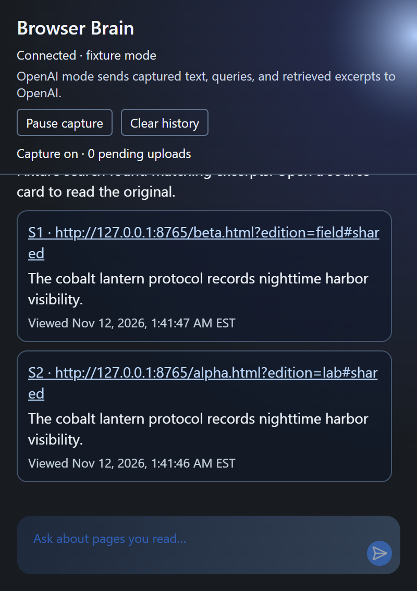

# Browser Brain

**Tìm lại trang bạn đã đọc, kể cả khi chỉ nhớ nội dung.**

Bạn nhớ mình từng đọc về một cách quan sát cảng ban đêm, nhưng quên tên bài và địa chỉ? Mở Browser Brain trong Chrome, hỏi bằng lời của bạn, rồi bấm vào kết quả để trở lại trang gốc. Mỗi thẻ nguồn có một đoạn trích và thời điểm bạn đã xem.

[Thử với trang mẫu](#try-demo) · [Cài trên Windows](#windows-setup) · [Dữ liệu của bạn](#your-data) · [Xử lý lỗi](#troubleshooting)

<a href="docs/screenshots/browser-brain-search.png"></a>

*Ảnh chụp Chrome từ bản demo. Hai trang mẫu có cùng một đoạn văn. Mỗi thẻ vẫn mở đúng trang của nó.*

## Bạn dùng thế nào?

| Bạn muốn | Thao tác trong Chrome |
| --- | --- |
| Ghi nhớ các trang sắp đọc | Mở Browser Brain và bấm **Enable capture**. Đọc các trang HTTP(S) như bình thường. |
| Tìm lại một chi tiết | Đợi số **pending uploads** về 0, rồi nhập câu hỏi. Bấm vào thẻ nguồn để mở URL gốc. |
| Tạm dừng ghi nhận | Bấm **Pause capture**. Những mục đã xếp hàng vẫn được gửi khi có kết nối. |
| Xóa dữ liệu Browser Brain | Bấm **Clear history**. Thao tác này xóa nội dung đã lưu, chat và hàng đợi của Browser Brain. |

Nếu mất kết nối với chương trình chạy trên máy, các mục đã vào hàng đợi vẫn được giữ khi bạn đóng popup. Extension thử gửi lại sau khi kết nối phục hồi. Nếu lần gửi trước đã ghi dữ liệu, lần gửi lại sẽ dùng lại bản ghi đó.

<a id="try-demo" name="try-demo"></a>

## Thử với trang mẫu

Bản demo dùng hai trang giả lập và chạy không cần khóa OpenAI. Sau khi cài theo hướng dẫn bên dưới, mở [trang Harbor field notes](http://127.0.0.1:8765/alpha.html?edition=lab#shared), bấm **Enable capture**, rồi chọn **Open marsh notes** trong cùng tab. Hai trang đều nhắc đến *cobalt lantern protocol*.

Khi hàng đợi đã gửi xong, hỏi **“What does the cobalt lantern protocol record?”** trong popup. Bạn sẽ thấy hai thẻ. Thử bấm vào một thẻ và đối chiếu URL cùng dòng **Viewed**. [Walkthrough mất kết nối và phục hồi](docs/demo.md)

<a id="windows-setup" name="windows-setup"></a>

## Cài trên Windows

Bạn cần **Chrome 120 trở lên**, **Node.js 24**, **Git** và **uv** để cài Python và chạy chương trình trên máy. Chrome extension được cài từ thư mục bạn build. [Cài Node.js](https://nodejs.org/en/download) · [Cài Git](https://git-scm.com/install/windows) · [Cài uv](https://docs.astral.sh/uv/getting-started/installation/)

### 1. Tải và build

Mở PowerShell ở thư mục bạn muốn đặt dự án. Nếu đã có thư mục dự án, mở PowerShell tại đó và bắt đầu từ `Set-Location web-extension`.

```powershell
git clone https://github.com/DTran228/browser-brain.git
Set-Location browser-brain
Set-Location web-extension
npm.cmd ci
npm.cmd run build
Set-Location ..
```

Nếu GitHub yêu cầu đăng nhập khi tải, dùng tài khoản có quyền truy cập repo.

Trong Chrome, mở `chrome://extensions`, bật **Developer mode**, bấm **Load unpacked** và chọn thư mục `web-extension\dist` vừa tạo. Ghim Browser Brain từ menu Extensions để dễ mở lại.

### 2. Chạy chương trình trên máy

Từ thư mục dự án, chạy:

```powershell
Set-Location backend
uv python install 3.11
uv sync --locked
$env:BROWSER_BRAIN_PROVIDER = 'fixture'
$env:BROWSER_BRAIN_DATA = Join-Path (Split-Path -Parent $PWD.Path) '.local\readme-demo'
uv run --locked python src/main.py
```

Giữ cửa sổ PowerShell này mở. Popup sẽ hiện **Connected · fixture mode**. Nếu trang demo đã mở trước khi cài extension, hãy tải lại trang.

### 3. Mở hai trang demo

Mở **một cửa sổ PowerShell khác tại thư mục dự án** và chạy:

```powershell
.\backend\.venv\Scripts\python.exe -m http.server 8765 --bind 127.0.0.1 --directory demo
```

Quay lại [bài thử với hai trang mẫu](#try-demo). Khi dùng xong, bấm **Ctrl+C** trong hai cửa sổ PowerShell để dừng chương trình.

<details>
<summary><strong>Dùng Browser Brain với các trang bạn đọc</strong></summary>

Dừng hai chương trình demo và dùng một profile Chrome riêng cho các trang cá nhân. Mở **PowerShell mới** tại thư mục dự án để bắt đầu với cấu hình riêng.

```powershell
Set-Location backend
if (!(Test-Path .env)) { Copy-Item .env.example .env }
notepad .env
```

Điền `OPENAI_API_KEY`, giữ `BROWSER_BRAIN_PROVIDER=openai` rồi lưu file. Chạy `uv run --locked python src/main.py` trong cùng cửa sổ. Mở extension, kiểm tra dòng **Connected to local backend**, rồi bật ghi nhận. Các lần sau bạn chỉ cần chạy lại lệnh khởi động từ thư mục `backend`.

</details>

<a id="your-data" name="your-data"></a>

## Dữ liệu của bạn

- **Bạn chọn khi nào ghi nhận.** Ghi nhận mặc định tắt. Browser Brain lấy văn bản từ các khối hiển thị trên trang như đoạn văn, tiêu đề và mục danh sách.
- **Dữ liệu được lưu trên máy.** Chrome giữ các mục đang chờ gửi. Chương trình Browser Brain lưu nội dung và chat trong thư mục dữ liệu của bạn, mặc định là `%USERPROFILE%\.browser-brain` khi dùng OpenAI.
- **OpenAI xử lý dữ liệu trong chế độ dùng thật.** Chương trình gửi văn bản đã ghi và câu hỏi để tìm các đoạn liên quan, rồi gửi câu hỏi, đoạn trích và thời điểm xem để tạo câu trả lời. Khóa API nằm trong `backend/.env` trên máy bạn.
- **Bạn có thể xóa bất cứ lúc nào.** **Clear history** tạm dừng ghi nhận và xóa dữ liệu Browser Brain, kể cả mục đang chờ. Nếu mất kết nối trong lúc xóa, mở lại popup và chọn **Finish clearing** sau khi chương trình đã chạy. Chrome quản lý lịch sử duyệt web của Chrome riêng.

<a id="troubleshooting" name="troubleshooting"></a>

## Xử lý lỗi

| Bạn thấy gì? | Thử làm gì? |
| --- | --- |
| **Backend disconnected** | Kiểm tra cửa sổ chạy chương trình ở bước 2. Bạn có thể mở [trang kiểm tra kết nối](http://127.0.0.1:8000/health) khi chương trình đang chạy. |
| **Pending uploads** chưa về 0 | Đợi vài giây để các đoạn được gom và gửi. Nếu có lỗi mạng, mở lại chương trình và đợi extension thử lại. |
| **No relevant indexed sources found** | Kiểm tra trang đã được đọc khi ghi nhận đang bật. Thử hỏi về một chi tiết cụ thể hơn sau khi các mục chờ đã gửi xong. |
| Chrome vẫn dùng bản build cũ | Tại `chrome://extensions`, bấm **Reload** cho Browser Brain, rồi tải lại trang đang đọc. |
| Popup yêu cầu khóa OpenAI | Chọn cấu hình demo ở bước 2, hoặc điền khóa trong `backend/.env` và khởi động lại chương trình. |

## Đã kiểm tra

Bản build đã chạy trên Chrome headless với Qdrant lưu trên đĩa và dữ liệu mẫu. Bài thử có hai nguồn trùng đoạn văn, một phản hồi tải lên bị ngắt và một lần extension worker khởi động lại. Kết quả trả đúng hai nguồn với giờ xem riêng. Chất lượng tìm kiếm với OpenAI thật và thời gian người dùng tìm lại nguồn còn cần đo. [Kết quả kiểm thử](docs/demo.md) · [Quy trình đo với người dùng](docs/evaluation.md)

<details>
<summary><strong>Dành cho người phát triển</strong></summary>

Browser Brain dùng Chrome extension TypeScript/React, FastAPI và Qdrant. Qdrant chạy trên máy theo mặc định. Đặt `QDRANT_URL` trong `backend/.env` nếu dùng máy chủ Qdrant riêng. Xem [kiến trúc, phần đóng góp và ghi công](docs/architecture.md).

Chạy các kiểm tra từ thư mục dự án:

```powershell
Set-Location web-extension
npm.cmd run typecheck
npm.cmd test
npm.cmd run build

Set-Location ..\backend
$env:PYTHONPATH = 'src'
uv run --locked python -m pytest -q

Set-Location ..
node demo/walkthrough.mjs
```

Walkthrough tự động cần Chrome đã cài, build trong `dist`, môi trường `backend\.venv` và các cổng 8000, 8001, 8765 đang trống.

</details>
